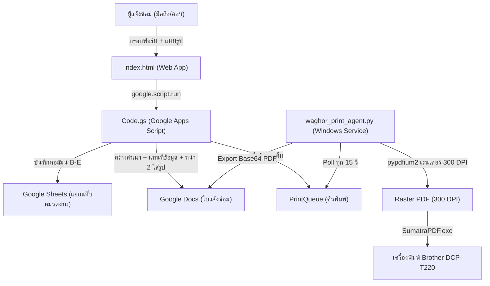

# 📑 เอกสารสรุปส่งมอบระบบแจ้งซ่อม/แจ้งติดตั้ง และระบบสั่งพิมพ์อัตโนมัติ (Handover Dossier)
**อุทยานวิทยาศาสตร์พระจอมเกล้า ณ หว้ากอ จังหวัดประจวบคีรีขันธ์**  
*ปรับปรุงข้อมูลล่าสุด: 21 พฤศจิกายน 2569*

---

## 1. วัตถุประสงค์และภาพรวมของระบบ (System Overview)
ระบบนี้ถูกออกแบบมาเพื่อให้บริการแจ้งซ่อมและแจ้งติดตั้งอุปกรณ์ภายในอุทยานวิทยาศาสตร์พระจอมเกล้า ณ หว้ากอ แบบครบวงจร (End-to-End):
1. **ผู้แจ้ง (Client)**: กรอกแบบฟอร์มผ่านเว็บ/มือถือ พร้อมแนบรูปถ่ายสถานที่จริงหรือจุดชำรุด (1–6 รูป)
2. **ระบบประมวลผล (Google Apps Script Backend)**:
   - บันทึกข้อมูลลง Google Sheets แยกแท็บตามหมวดงานอัตโนมัติ (**งานอาคารสถานที่** หรือ **งานช่างเทคนิค**)
   - เขียนข้อมูลเฉพาะคอลัมน์ B ถึง E (ปล่อยคอลัมน์ F เป็นต้นไปไว้ให้เจ้าหน้าที่ผู้รับเอกสารบันทึก)
   - ทำสำเนาไฟล์แม่แบบ (Google Doc Template) แทนที่ตัวแปร `{{...}}`
   - หากมีรูปภาพแนบ จะเพิ่มหน้า 2 และจัดวางรูปภาพตามสัดส่วนกระดาษ A4
   - บันทึกคิวพิมพ์ลงในแท็บ `PrintQueue`
3. **ระบบสั่งพิมพ์อัตโนมัติ (Local Print Agent บน Windows)**:
   - ทำงานเป็น Background Service (pythonw.exe) ตรวจสอบคิวพิมพ์ทุก 15 วินาที
   - ดึงไฟล์ PDF แปลงเป็นภาพ Raster 300 DPI คมชัดสูงผ่าน Chromium PDFium Engine
   - สั่งพิมพ์ไปยังเครื่องพิมพ์ **Brother DCP-T220** แบบเงียบ (Silent Print) โดยอัตโนมัติ

---

## 2. ข้อมูลประจำระบบ รหัสลับ และลิงก์สำคัญ (Credentials & IDs)

| รายการ | ค่าที่ตั้งไว้ (Config Value) | หมายเหตุ |
| :--- | :--- | :--- |
| **Web App URL** | `https://script.google.com/macros/s/AKfycbwcUeTiWoxetMbZHburOufSYC99Mp746wqmr5hkYD2dlrkLk14oqRaZ94WJD9kdSEnblw/exec` | Execute as: Me, Who has access: Anyone |
| **Spreadsheet ID** | `1k47ZtI4e4PMCZO7-VqouOFpVTgEyZHezY0j87bgD1w8` | [เปิด Google Sheets](https://docs.google.com/spreadsheets/d/1k47ZtI4e4PMCZO7-VqouOFpVTgEyZHezY0j87bgD1w8/edit) |
| **Active Template Doc ID** | `1P62_Hxuz4c2YnW3nQmzug6wBp6jC5Uo4eGxhOL_dOCA` | [Template_ใบแจ้งซ่อม_Sarabun_หว้ากอ](https://docs.google.com/document/d/1P62_Hxuz4c2YnW3nQmzug6wBp6jC5Uo4eGxhOL_dOCA/edit) |
| **Old Template Doc ID** | `1FmRIg-RrLkNWMWv9Dv8b_g1dr0cdEGq3kgiqaqzJuLY` | เทมเพลตเดิม (ฟอนต์ Tahoma 21pt) |
| **Output Folder ID** | `1_zNg4ILVpf1ATLF-hOZopfK2Cmhn4gVv` | โฟลเดอร์ใน Google Drive ที่เก็บไฟล์ใบแจ้งซ่อมที่เจนออกมา |
| **Print API Key** | `WAGHOR-PRINT-2026-SECRET` | รหัสยืนยันตัวตนระหว่าง Print Agent กับ Web App |
| **Printer Name** | `Brother DCP-T220 Printer` | พอร์ต USB001, ชนิด Inkjet สี, หมึกแท้ |

---

## 3. สภาพแวดล้อมและที่อยู่ไฟล์บนเครื่อง Windows (Local Environment)

### 3.1 ที่อยู่โฟลเดอร์หลัก:
* **โฟลเดอร์รันโปรแกรมจริง**: `C:\WaghorPrintAgent\`
* **โฟลเดอร์สำรอง**: `C:\Users\Naity\.gemini\antigravity\scratch\waghor_repair_system\`

### 3.2 รายการไฟล์ใน `C:\WaghorPrintAgent\`:
1. **`Code.gs`**: ซอร์สโค้ดฝั่ง Google Apps Script (Backend)
2. **`index.html`**: ซอร์สโค้ดหน้าเว็บฟอร์ม (Frontend) รองรับการอัปโหลดและย่อรูปภาพในตัว
3. **`waghor_print_agent.py`**: สคริปต์ Python สำหรับตรวจสอบคิวและสั่งพิมพ์
4. **`start_print_agent.bat`**: แบตช์ไฟล์สำหรับสั่งรัน Agent แบบซ่อนหน้าต่าง
5. **`SumatraPDF.exe`**: SumatraPDF Portable 3.5.2 64-bit ใช้สำหรับพิมพ์ PDF แบบเงียบ
6. **`SumatraPDF-settings.txt`**: ไฟล์ตั้งค่าของ SumatraPDF

### 3.3 การตั้งค่าระบบ Windows:
* **Python Runtime**: `C:\Users\Naity\AppData\Local\Python\pythoncore-3.15-64\pythonw.exe` (Python 3.15.2 64-bit)
* **Python Libraries ที่ติดตั้งแล้ว**: `pypdfium2` (PDFium Chromium Engine), `Pillow`
* **Windows Task Scheduler**: Task ชื่อ `WaghorPrintAgent` (รันตอนเปิดเครื่อง/Log on)
* **Startup Folder**: มีชอร์ตคัต `start_print_agent.bat` อยู่ที่ `C:\Users\Naity\AppData\Roaming\Microsoft\Windows\Start Menu\Programs\Startup\`
* **ฟอนต์ที่ติดตั้งในเครื่อง**: `Sarabun-Regular.ttf`, `Sarabun-Bold.ttf`, `Sarabun-Medium.ttf` ใน `C:\Users\Naity\AppData\Local\Microsoft\Windows\Fonts\`
* **การตั้งค่าเครื่องพิมพ์ใน Windows**: สั่งคำสั่ง `Set-PrintConfiguration -PrinterName "Brother DCP-T220 Printer" -PaperSize A4` เรียบร้อยแล้ว (ตรวจสอบใน PrintTicket เป็น A4)

---

## 4. รายละเอียดโค้ดและการทำงานของแต่ละส่วน

### 4.1 `Code.gs` (Google Apps Script)
* **`CONFIG`**: บรรจุ ID ต่างๆ ของ Drive/Sheets/Doc
* **`doGet(e)`**:
  * บริการหน้าเว็บฟอร์ม (เมื่อไม่มีพารามิเตอร์)
  * บริการ API สำหรับ Print Agent เมื่อมีพารามิเตอร์ `action`:
    * `action=queue`: ส่งรายการคิวที่ค้างพิมพ์ (Status != PRINTED)
    * `action=pdf&docId=...`: ดึง Base64 PDF ผ่าน `https://docs.google.com/document/d/{docId}/export?format=pdf`
    * `action=markPrinted&jobId=...`: อัปเดตสถานะในชีต PrintQueue เป็น `PRINTED`
* **`submitRepairRequest(form)`**:
  * สร้างสำเนาแม่แบบจาก `TEMPLATE_DOC_ID`
  * บังคับขนาดหน้ากระดาษ A4 (`body.setPageWidth(595.28)`, `body.setPageHeight(841.89)`)
  * แทนที่ตัวแปร: `{{DAY}}`, `{{MONTH}}`, `{{YEAR}}`, `{{SUBJECT}}`, `{{CHK_INSTALL}}`, `{{CHK_REPAIR}}`, `{{CHK_OTHER}}`, `{{OTHER_TEXT}}`, `{{DETAIL}}`, `{{REPORTER_NAME}}`
  * เรียก `appendImagesToDoc` หากมีภาพแนบ
  * บันทึกลง Google Sheets: ค้นหาแท็บตามหมวดงาน (งานอาคารสถานที่ / งานช่างเทคนิค) เขียนเฉพาะคอลัมน์ B ถึง E
  * ปลดล็อก Data Validation คอลัมน์ B ก่อนเขียน เพื่อไม่ให้ติด Dropdown Lock
  * เพิ่มคิวลงแท็บ `PrintQueue`
* **`appendImagesToDoc(body, images, building, location, reporterName)`**:
  * เพิ่ม Page Break (`body.appendPageBreak()`) ขึ้นหน้าที่ 2
  * ใส่หัวเรื่อง Sarabun 16pt หนา
  * ปรับสัดส่วนภาพอัตโนมัติ (`fitImage`):
    * 1 รูป: ตรงกลางขนาดใหญ่ (max 460 x 560 pt)
    * 2 รูป: ตรวจจับแนวตั้ง/แนวนอน จัดเรียงซ้อนบน-ล่าง หรือตาราง 2 คอลัมน์
    * 3–4 รูป: ตาราง 2x2 (max 225 x 250 pt)
    * 5–6 รูป: ตาราง 2x3 (max 225 x 175 pt)

### 4.2 `index.html` (Web Form)
* หน้าเว็บ Responsive สวยงาม ฟอนต์ Sarabun
* มีระบบเลือกอาคาร (พิพิธภัณฑ์สัตว์น้ำ, เพาะเลี้ยงสัตว์น้ำ, สุขภาพสัตว์น้ำ หรือระบุเอง)
* **ระบบแนบภาพ (Image Attachment)**:
  * Drag & Drop หรือคลิกเลือกรูปภาพ (สูงสุด 6 รูป)
  * บีบอัดรูปภาพฝั่งเบราว์เซอร์อัตโนมัติด้วย HTML5 Canvas (`maxDim = 1280px`, JPEG quality `0.82`) ช่วยให้รูปถ่ายมือถือ 5–10MB เหลือเพียง ~150–200KB ส่งข้อมูลได้ไวมาก
  * แสดง Preview Grid พร้อมปุ่มกากบาทสีแดงลบรูปภาพได้เป็นรายรูป
  * ส่งข้อมูลภาพเป็น Base64 array ใน payload

### 4.3 `waghor_print_agent.py` (Local Python Agent)
* ตรวจสอบคิวผ่าน API ทุก 15 วินาที
* เมื่อพบคิวใหม่:
  * ดาวน์โหลด Base64 PDF
  * เรียก `prepare_printable_pdf(pdf_bytes)`:
    * ใช้ `pypdfium2` เรนเดอร์ทุกหน้าของ PDF เป็นภาพ 300 DPI
    * รวมภาพเป็น Raster PDF บันทึกลงไฟล์ชั่วคราว
  * เรียก `print_pdf_silent(tmp_pdf, printer_name)`:
    * ใช้ `SumatraPDF.exe -print-to "Brother DCP-T220 Printer" -print-settings "noscale,paper=A4" {pdf_path}`
  * ส่ง `action=markPrinted` กลับไปอัปเดต Google Sheets

---

## 5. ประวัติสิ่งที่เคยแก้สำเร็จแล้ว (Resolved Issues)
1. **Google Sheets Data Validation Error**: เซลล์คอลัมน์ B มี Dropdown ล็อกไว้ -> แก้โดยใช้ `clearDataValidations()` และระบบ Fallback
2. **Tab Name Mismatch**: หาชื่อแท็บไม่เจอ -> แก้โดยทำ Smart Keyword Matching ค้นหาทั้ง "อาคาร", "สถานที่", "เทคนิค", "ช่าง"
3. **Column F Overwrite Protection**: ผู้รับเอกสารใช้งานตั้งแต่คอลัมน์ F -> แก้ให้ระบบเขียนเฉพาะคอลัมน์ B ถึง E เท่านั้น
4. **Cloudflare CAPTCHA Block**: ดาวน์โหลด PDFtoPrinter.exe ไม่ได้ -> เปลี่ยนมาใช้ SumatraPDF Portable
5. **Brother Printer Font Substitution (Tahoma Bug)**:
   * แม่แบบเดิมใช้ Tahoma 21pt ไดรเวอร์ Brother ไม่รู้จักฟอนต์ไทยของ Tahoma ในเวกเตอร์ PDF จึงดึงฟอนต์หนาไม่มีหัวมาแทน ทำให้ตัวหนังสือลอยและเละ
   * แก้โดยใช้ PDFium Rasterization 300 DPI ก่อนสั่งพิมพ์
6. **Multi-page Printing**: สคริปต์เดิมพิมพ์เฉพาะ `doc[0]` -> ปรับเป็น `save_all=True` พิมพ์ครบทุกหน้า (หน้า 1 ใบแจ้งซ่อม + หน้า 2 ภาพประกอบ)

---

## 6. ปัญหาปัจจุบันที่ยังค้างอยู่ (The Active Unresolved Problem)

### 🔴 อาการของปัญหา:
ผู้ใช้รายงานว่า **"สิ่งที่พิมพ์ออกมาไม่ตรงกับเทมเพลต นายได้จัดขนาดกระดาษเป็น A4 ยัง"** (พร้อมส่งภาพถ่ายแผ่นกระดาษจริงที่พิมพ์ออกมา)

จากการวิเคราะห์อย่างละเอียดพบว่า:
1. **เนื้อหาข้อความตรงตามเทมเพลตใหม่แล้ว**:
   - บนกระดาษมี `กพ. ........../..........`
   - มี `ส่วนที่ 1`, `ส่วนที่ 2`, `ส่วนที่ 3`
   - ฟอนต์เป็น Sarabun ถูกต้อง
2. **แต่ "สัดส่วนแนวตั้ง (Vertical Layout/Spacing) บนกระดาษพิมพ์จริง" ไม่สมดุล**:
   - ข้อความทั้งหมดบนหน้า 1 (ตั้งแต่หัวเรื่องจนถึงลายเซ็นผู้รับ/ตรวจงาน) **ไปกระจุกตัวอยู่แค่ประมาณ 65–70% ด้านบนของแผ่นกระดาษ A4**
   - ส่งผลให้**ด้านล่างของแผ่นกระดาษเหลือพื้นที่ว่างสีขาวโพลนขนาดใหญ่มาก (~8–10 ซม.)**
   - ในขณะที่ผู้ใช้ต้องการให้เนื้อหาในหน้า 1 กระจายตัวเต็มแผ่นกระดาษ A4 พอดี โดยให้ลายเซ็น `ผู้รับ/ตรวจงาน` อยู่ใกล้ขอบล่างของกระดาษ (เหมือนแบบฟอร์มราชการทั่วไป)
3. **อาการแทรกซ้อน (Ghost/Overlap ในภาพถ่าย)**:
   - ในภาพถ่ายของผู้ใช้ พบว่าแผ่นกระดาษหน้า 1 มีเงาภาพหัวกะโหลกจากหน้า 2 ส่องทะลุออกมา (ต้องตรวจสอบว่าผู้ใช้ถือแผ่นหน้า 1 ซ้อนหน้า 2 ส่องกับแสงไฟ หรือเกิดการพิมพ์หน้า-หลัง 2-Sided/Duplex ลงบนแผ่นเดียวกัน)

---

## 7. สมมติฐานและแนวทางแก้ไขสำหรับ AI ท่านถัดไป (Actionable Next Steps)

### แนวทางที่ 1: ปรับแต่งระยะห่าง (Spacing) ในไฟล์เทมเพลตต้นฉบับ (แนะนำที่สุด)
* **สาเหตุ**: เทมเพลตใหม่ `Template_ใบแจ้งซ่อม_Sarabun_หว้ากอ` (`1P62_Hxuz4c2YnW3nQmzug6wBp6jC5Uo4eGxhOL_dOCA`) มีระยะห่างระหว่างบรรทัด (Line Spacing) ค่อนข้างแคบ (1.15) และไม่มี Space Before/After ระหว่างส่วนที่ 1, ส่วนที่ 2 และส่วนที่ 3
* **วิธีแก้**:
  1. เปิดไฟล์เทมเพลต [1P62_Hxuz4c2YnW3nQmzug6wBp6jC5Uo4eGxhOL_dOCA](https://docs.google.com/document/d/1P62_Hxuz4c2YnW3nQmzug6wBp6jC5Uo4eGxhOL_dOCA/edit)
  2. เพิ่ม Space Before/After ให้กับหัวข้อ `ส่วนที่ 1`, `ส่วนที่ 2`, `ส่วนที่ 3` และช่องความคิดเห็นหัวหน้ากลุ่ม
  3. หรือปรับขนาดฟอนต์ของเนื้อหาจาก 14pt เป็น 15pt หรือ 16pt (ขนาดมาตรฐานสารบรรณคือ 16pt)
  4. เพิ่มจำนวนเส้นจุดประในช่องความคิดเห็นหรือรายละเอียดการซ่อม เพื่อดึงให้ส่วนท้าย (`ผู้รับ/ตรวจงาน`) ขยับลงไปอยู่ตำแหน่ง 2.5 ซม. จากขอบล่างของหน้ากระดาษ A4

### แนวทางที่ 2: ตรวจสอบคำสั่งการพิมพ์ของ SumatraPDF
* ใน `waghor_print_agent.py`:
  * ปัจจุบันเพิ่งเปลี่ยนเป็น: `SUMATRA_PDF_PATH, "-print-to", printer_name, "-print-settings", "noscale,paper=A4", pdf_path`
  * ต้องให้ผู้ใช้ทดสอบพิมพ์ด้วยคำสั่ง `noscale` นี้หลังจากที่ได้สั่ง `Set-PrintConfiguration -PaperSize A4` แล้ว ว่าข้อความขยายเต็มแผ่นหรือยัง
  * หาก Brother DCP-T220 มี Hardware Printable Margin ให้ทดสอบเปรียบเทียบระหว่าง `-print-settings "noscale,paper=A4"` กับ `-print-settings "shrink,paper=A4"`

### แนวทางที่ 3: ตรวจสอบการพิมพ์ 2 หน้า (Duplex vs Simplex)
* ตรวจสอบว่า Brother DCP-T220 พิมพ์หน้า 1 และหน้า 2 ออกมาเป็นกระดาษ 2 แผ่นแยกกัน (Simplex) หรือพยายามพิมพ์แบบ 2 หน้า (Duplex) เพื่อป้องกันไม่ให้หมึกซึมหรือภาพทับซ้อนกัน

---

*เอกสารฉบับนี้จัดทำขึ้นเพื่อให้ข้อมูลครบถ้วน ชัดเจน และสามารถนำไปทำงานต่อได้ทันที 100%*
